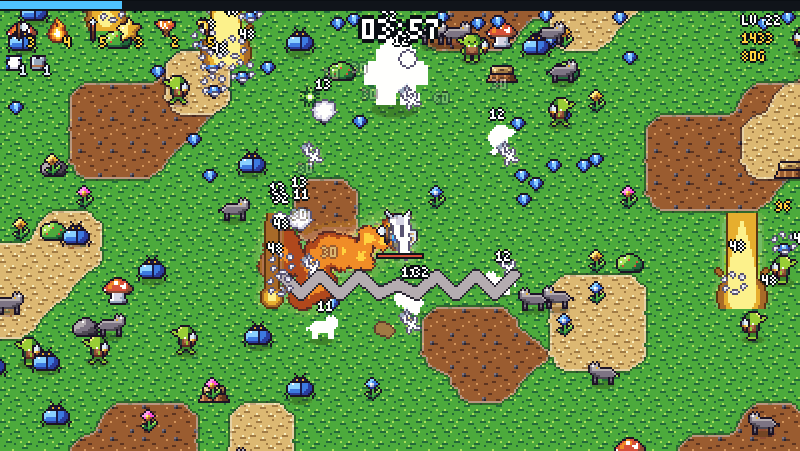

# WORLDFALL

하늘에서 쏟아지는 괴물 떼를 세계 각지의 영웅이 막아 내는 서바이버 장르 게임입니다. 무기는 알아서 나가고, 당신은 움직이며 살아남으면 됩니다.
**모든 캐릭터, 몬스터, 땅, 무기 효과, 효과음, 음악이 [PixSpell](https://github.com/olebangpad/pixspell) 코드로 만들어집니다.** 이 저장소에는 이미지나 소리 파일이 하나도 없습니다.

A survivors-like where heroes from around the world hold off a falling horde. Every character, monster, tile, weapon
effect, sound and song is drawn by [PixSpell](https://github.com/olebangpad/pixspell) code: there are no image or audio files here.



**▶ 하기: https://olebangpad.github.io/webdev1/** · 혼자 하는 모습 보기: [`?demo`](https://olebangpad.github.io/webdev1/?demo)

## 하는 법

방향키 / WASD(휴대폰은 화면을 끌기)로 움직입니다. 무기는 저절로 나갑니다. 보석을 모아 레벨이 오르면 무기나 능력을 하나 고릅니다.
4분에 중간 보스, 7분 30초에 **용왕(THE DRAGON KING)** 이 나옵니다. 쓰러뜨리면 승리.
Esc 일시정지 · M 소리 · P 레트로 색(게임보이, PICO-8, C64…) · 제목 화면에서 T를 누르면 큰 키 영웅.

## 영웅 10명

| 영웅 | 출신 | 처음 무기 |
| --- | --- | --- |
| 사무라이 | 일본 | 카타나: 가까운 적을 벤다 |
| 바이킹 | 스칸디나비아 | 땅을 내려찍는 도끼 |
| 한복 무희 | 한국 | 적을 따라가는 꽃잎 부채 |
| 기마 궁수 | 몽골 | 가장 가까운 적에게 화살 |
| 켄테 | 가나 | 연쇄 번개 지팡이 |
| 군단병 | 로마 | 줄지어 꿰뚫는 창 |
| 머스킷티어 | 프랑스 | 빠른 찌르기 |
| 아웃백 레인저 | 호주 | 돌아오는 부메랑 |
| 파라오 | 이집트 | 하늘에서 내리꽂는 햇빛 |
| 조선 선비 | 한국 | 주위를 도는 주문책 |

여기에 길에서 얻는 무기 9가지(성스러운 오라, 서리 폭발, 운석, 회오리, 독 구름, 폭탄, 수리검, 용의 숨결, 공허 구슬)와 능력 10가지가 있습니다.
무기 6개, 능력 6개까지 들 수 있고 각각 5레벨까지 오릅니다.

## 무대 3곳

- **GREEN MEADOW**: 슬라임, 쥐, 벌, 늑대, 고블린. 보스: 돌의 왕 → 용왕
- **SUNKEN SANDS**: 지렁이, 뱀, 전갈, 미라, 해골 전사. 보스: 모래의 파라오 → 용왕
- **FROST HOLLOW**: 펭귄, 도깨비불, 유령, 해골, 설인. 보스: 서리의 왕 → 용왕

## PixSpell로 그린 것들

| 게임 속 | PixSpell 호출 |
| --- | --- |
| 영웅 10명, 8방향으로 걷기 | `spell.char.world` 프리셋 → `spell.walk(spec, 'down-left')` |
| 몬스터 24종, 보스(왕관, 두 배 크기) | `spell.walk({ body: 'golem', hat: 'crown' }, dir)` → `.scale(2)` |
| 끝없이 이어지는 땅 | 주기적인 잡음 → `spell.autotile('dirt', null).draw(cells)` 를 이음매 없이 반복 |
| 무기 효과 19가지 | `spell.fx('cross-slash' / 'chain-lightning' / 'meteor' / 'tornado' / 'black-hole' / 'dragon-breath' …)` |
| 아이콘, 보석, 상자, 고기 | `spell('held-katana')`, `spell('gem-emerald', { grid: 8 })`, `spell.frames('chest-gold')` |
| 맞았을 때 하얗게 번쩍 | 프레임마다 `img.map((c) => [255, 255, 255, c[3]])` |
| 효과음과 무대별 음악 | `spell.sfx('slash')`, `spell.music.play('field' / 'desert' / 'snow')` |
| 레트로 색 | `spell.palette('gameboy')` 뒤에 다시 그리기 |
| 글자 | `text('LEVEL UP!')` |

## 직접 돌려 보기

빌드 과정이 없는 정적 페이지입니다. 아무 정적 서버로 `index.html` 을 열면 됩니다. PixSpell은 jsDelivr에서 고정된 버전으로 불러옵니다.

```bash
python3 -m http.server 8080      # http://localhost:8080
```

오프라인 개발: 이 저장소 옆에 PixSpell을 `dog` 라는 폴더로 받아 두고, 둘을 담은 폴더에서 서버를 띄운 뒤 `/webdev1/index.html?local` 로 엽니다.
`?demo&warm=200&stage=meadow&hero=viking` 처럼 주소를 주면 그 영웅과 무대로 200초 진행된 데모가 바로 시작됩니다. `scripts/record.cjs` 가 이걸로 `docs/worldfall.gif` 를 녹화합니다.

```
src/data.js     영웅, 무기, 능력, 몬스터, 무대, 웨이브
src/game.js     시뮬레이션: 등장, 이동(공간 격자), 무기 19종의 동작, 보석, 레벨업, 보스
src/render.js   그리기: 땅, 몬스터, 효과, HUD, 레벨업 카드, 제목 화면
src/pix.js      PixSpell 불러오기, 한 번 그린 것 보관, 소리, 팔레트
src/main.js     화면 전환, 입력(키보드, 터치), 데모 조종사
```

## 브랜치

- `main`: WORLDFALL
- `mmo`: 고전 온라인 RPG 감성의 멀티플레이 게임(달무리 온라인). Node 서버가 필요합니다. 그 브랜치의 README를 보세요.

## 라이선스

코드는 MIT, PixSpell의 그림과 소리는 CC0.
