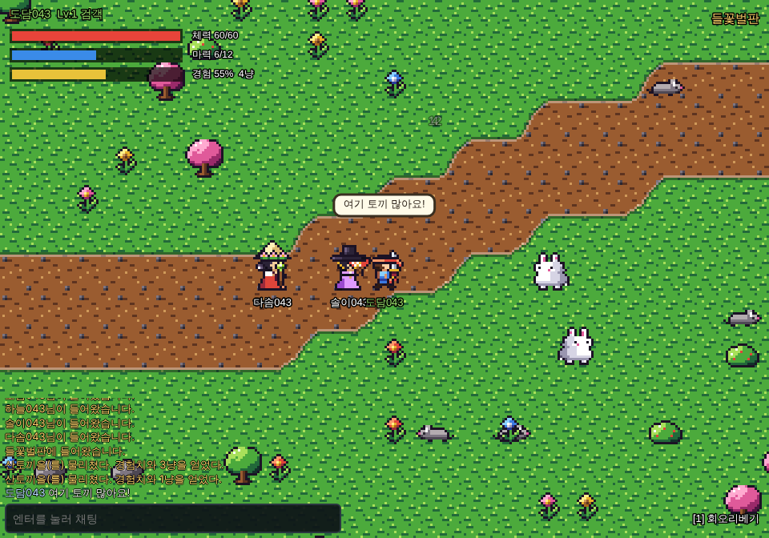

# 달무리 온라인

브라우저에서 바로 하는 작은 온라인 RPG입니다. 같은 서버에 접속한 사람들이 한 마을에서 만나 같이 사냥하고, 이야기하고, 레벨을 올립니다.
90년대 PC통신과 초창기 온라인 RPG 감성(타일을 한 칸씩 걷는 탑뷰, 직업, 사냥, 채팅)을 바탕으로 새로 지은 세계입니다.

**모든 그림, 효과, 효과음, 음악은 [PixSpell](https://github.com/olebangpad/pixspell) 코드로 만들었습니다.** 저장소에 게임용 이미지나 소리 파일이 하나도 없습니다.



## 하는 법

| 키 | 하는 일 |
| --- | --- |
| 방향키 / WASD | 한 칸씩 걷기 (누르고 있으면 계속) |
| 스페이스 | 바라보는 쪽 공격, NPC를 보고 있으면 대화 |
| 1 또는 Q | 직업 스킬 |
| 엔터 | 채팅 (같은 지역 사람에게 말풍선과 채팅창으로 보입니다) |

휴대폰에서는 화면 아래 방향 버튼과 공격·기술 버튼을 씁니다. 캐릭터는 이름으로 서버에 저장되고, 같은 브라우저에서 같은 이름으로 들어오면 이어서 합니다.

## 세계

- **솔빛마을**: 시작하는 마을. 의녀 연화에게 말을 걸면 체력과 마력이 다 찹니다.
- **들꽃벌판**: 동쪽 문 밖. 산토끼, 들쥐, 청개구리, 이끼방울.
- **깊은숲**: 벌판의 동쪽. 잿빛늑대, 독사, 숲거미, 멧돼지, 그리고 숲 안쪽 공터의 **멧돼지왕**.

| 직업 | 특징 | 스킬 |
| --- | --- | --- |
| 검객 | 체력이 높은 근접 전사 | 회오리베기: 둘레 8칸을 한 번에 |
| 궁수 | 5칸 밖에서 쏘는 사냥꾼 | 연사: 화살 세 발 |
| 술사 | 부채로 불꽃 부적을 날리는 선비 | 화염부: 6칸까지 날아가는 강한 불꽃 |
| 의원 | 동료를 살리는 치유사 | 회복술: 자신과 주변 3칸 안의 사람을 치료 |

몬스터를 잡으면 준 피해만큼 경험치를 나눠 받고, 가장 많이 때린 사람이 돈(냥)을 받습니다. 쓰러지면 잠시 뒤 마을에서 깨어납니다.

## 직접 돌려 보기

Node.js 20 이상이 필요합니다.

```bash
npm install
npm start          # http://localhost:8080 을 여러 창으로 열면 혼자서도 멀티플레이를 볼 수 있어요
npm test           # 서버 규칙(이동, 전투, 경험치, 채팅, 저장) 테스트
```

`?bot&name=돌쇠&job=bow`를 주소 뒤에 붙이면 그 창은 혼자 사냥하는 봇이 됩니다 (테스트와 녹화용). `&to=forest`를 더하면 깊은숲까지 갑니다.

## 서버에 올리기

게임은 Node 서버 하나가 페이지와 실시간 연결(WebSocket)을 함께 맡습니다.

- **Render (무료로 시작하기 쉬움):** 이 저장소를 Render에 연결하면 `render.yaml` 대로 바로 올라갑니다. 무료 요금제는 15분 동안 아무도 없으면 잠들고(다음 접속 때 30초쯤 걸려 깨어남), 서버가 다시 시작되면 저장된 캐릭터가 사라질 수 있습니다.
- **캐릭터를 오래 보관하려면:** 디스크가 붙는 곳(Fly.io 볼륨, 작은 VPS 등)에서 `DATA_FILE=/data/players.json` 으로 저장 위치를 지정하세요.

환경 변수: `PORT`(기본 8080), `DATA_FILE`(캐릭터 저장 파일), `PIXSPELL_URL`(PixSpell을 불러올 주소, 기본은 고정된 버전의 jsDelivr CDN), `PIXSPELL_DIR`(로컬 PixSpell 폴더, 오프라인 개발용).

## 구조

```
shared/data.js     직업, 몬스터, 레벨 공식 (서버와 브라우저가 함께 씀)
shared/maps.js     지도: 시드로 만들어서 서버와 브라우저가 똑같은 지도를 가짐
server/world.js    세계 규칙: 이동, 몬스터 AI, 전투, 스킬, 경험치, 채팅, 저장. 전송 방식과 분리돼 테스트가 쉬움
server/index.js    웹 서버 + WebSocket, 초당 메시지 제한, 캐릭터 저장 파일
client/main.js     PixSpell로 그리기, 입력, 예측 이동, 효과, 소리, 음악
```

서버가 모든 판정을 합니다(어디에 있는지, 누가 누구를 얼마나 때렸는지). 브라우저는 내 걸음만 미리 움직여 보여 주고, 서버 결과와 다르면 맞춥니다.

## PixSpell로 그린 것들

| 게임 속 | PixSpell 호출 |
| --- | --- |
| 땅, 길, 연못, 기와집 | `spell('grass')`, `spell.autotile('cobblestone', null).draw(cells)`, `spell('roof-slate')`, `spell('planks')` |
| 나무, 꽃, 우물, 비석 | `spell('tree-cherry')`, `spell.frames('pine-tree')`, `spell('well')` |
| 플레이어와 NPC | `spell.walk({ body: 'seonbi', hat: 'gat', hand: 'fan', A: 'blue' }, 'left')` |
| 몬스터 | `spell.walk({ body: 'boar', hat: 'crown' }, dir)` |
| 타격, 화살, 불꽃 부적, 회오리, 치료, 레벨업 | `spell.fx('impact' / 'arrow' / 'energy-bolt' / 'whirlwind' / 'heal' / 'sparkle-burst')` |
| 효과음과 지역별 음악 | `spell.sfx('slash')`, `spell.music.play('town' / 'field' / 'forest')` |

## 라이선스

코드는 MIT. PixSpell의 그림과 소리는 CC0입니다. 글꼴은 둥근모꼴(SIL OFL)을 웹폰트로 불러옵니다.
