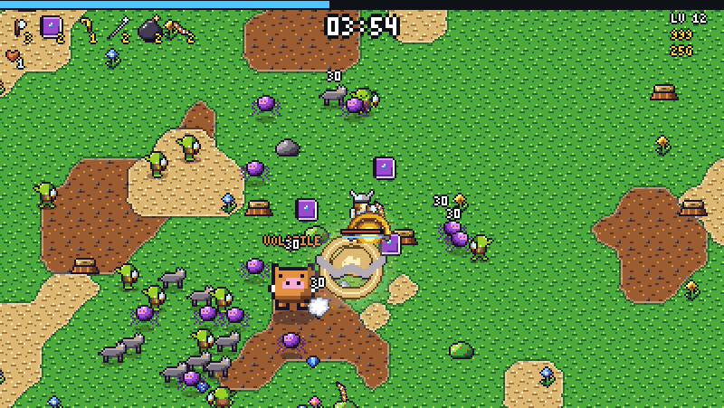

# WORLDFALL

하늘에서 쏟아지는 괴물 떼를 세계 각지의 영웅이 막아 내는 서바이버 장르 게임입니다. 무기는 알아서 나가고, 당신은 움직이며 살아남으면 됩니다.
**모든 캐릭터, 몬스터, 땅, 무기 효과, 효과음, 음악이 [PixSpell](https://github.com/olebangpad/pixspell) 코드로 만들어집니다.** 이 저장소에는 이미지나 소리 파일이 하나도 없습니다.

A survivors-like where heroes from around the world hold off a falling horde. Every character, monster, tile, weapon
effect, sound and song is drawn by [PixSpell](https://github.com/olebangpad/pixspell) code: there are no image or audio files here.



**▶ 하기: https://olebangpad.github.io/webdev1/** · 혼자 하는 모습 보기: [`?demo`](https://olebangpad.github.io/webdev1/?demo) · [English](https://olebangpad.github.io/webdev1/?lang=en)

## 하는 법

| 키 | 하는 일 |
| --- | --- |
| 방향키 / WASD | 이동 (무기는 저절로 나갑니다) |
| 스페이스 / Shift | 대시: 잠깐 빠르게 움직이며 그동안 아무것도 맞지 않습니다 |
| 1~4, 엔터 | 레벨업 카드 고르기 · R: 카드 다시 뽑기 (한 판에 2번) |
| Esc | 일시정지 (가진 무기와 진화 조합을 보여 줍니다) |
| U | 제목 화면에서 강화 상점 |
| L · M · P | 한국어/영어 · 소리 · 레트로 색 (게임보이, PICO-8, C64…) |

휴대폰에서는 화면을 누른 채 끌면 그 자리에 조이스틱이 생기고, 오른쪽 아래에 대시 버튼, 왼쪽 아래에 일시정지 버튼이 있습니다.
4분에 중간 보스, 7분 30초에 **용왕**이 나옵니다. 쓰러뜨리면 승리.

## 영웅 10명과 무기 진화

영웅의 무기를 5레벨까지 올리고 **짝이 되는 능력**을 가지고 있으면, 다음 레벨업에 금색 진화 카드가 나옵니다. 진화하면 숫자만 커지는 게 아니라 싸우는 방식이 바뀝니다.

| 영웅 | 처음 무기 | + 능력 | 진화 |
| --- | --- | --- | --- |
| 사무라이 (일본) | 카타나 | 힘 | **월광검**: 앞뒤를 베고 초승달 검기를 날린다 |
| 바이킹 (스칸디나비아) | 지진 도끼 | 활력 | **라그나로크**: 여진과 불기둥 |
| 한복 무희 (한국) | 꽃잎 부채 | 모래시계 | **꽃보라**: 적을 쫓는 꽃 여덟 송이 |
| 기마 궁수 (몽골) | 각궁 | 주사위 | **화살 폭풍**: 모두 꿰뚫는 화살 다섯 발 |
| 켄테 술사 (가나) | 폭풍 지팡이 | 마도서 | **뇌우**: 번개가 적에서 적으로 튄다 |
| 군단병 (로마) | 필룸 | 갑옷 | **팔랑크스**: 여덟 방향으로 창 |
| 총사 (프랑스) | 레이피어 | 장화 | **천 개의 바늘**: 긴 찌르기 세 번을 한꺼번에 |
| 아웃백 레인저 (호주) | 부메랑 | 나침반 | **별 차크람**: 큰 칼날 셋이 보석을 가져온다 |
| 파라오 (이집트) | 태양 광선 | 왕관 | **라의 눈**: 두 줄기 햇빛이 주위를 쓴다 |
| 조선 선비 (한국) | 주문책 | 사과 | **살아 있는 서고**: 두 겹의 책이 마법탄을 쏜다 |

길에서 얻는 무기 9가지(성스러운 오라, 서리 폭발, 운석, 회오리, 독 구름, 폭탄, 수리검, 용의 숨결, 공허 구슬)와 능력 10가지도 있습니다. 무기 6개, 능력 6개까지 듭니다.
영웅 넷은 처음부터 쓸 수 있고, 나머지 여섯은 모은 골드로 해금합니다.

## 몬스터는 그냥 걸어오지 않습니다

- **갈지자**: 벌, 뱀, 눈토끼가 좌우로 흔들며 다가옵니다.
- **돌진**: 늑대, 전갈, 펭귄, 멧돼지는 멈춰서 번쩍인 뒤 일직선으로 달려듭니다.
- **원거리**: 버섯, 임프, 해골은 거리를 두고 돌면서 뱉습니다. 적의 탄에는 빨간 테두리가 있습니다.
- **자폭**: 거미, 붉은 딱정벌레, 도깨비불은 옆에서 심지에 불을 붙입니다. 피하거나, 터지기 전에 잡으세요.
- **분열**: 슬라임과 지렁이는 죽으면 작은 둘로 갈라집니다.
- **미믹**: 가끔 다리 달린 보물상자가 나타나 도망칩니다. 잡으면 골드를 쏟습니다.
- **정예**: 1분마다 신속 · 중갑 · 소환사 · 폭발성 중 하나를 달고 옵니다.
- **보스**: 내려찍기, 낙석, 탄막, 소환, 얼음 가시, 불길, 운석, 돌진. 모든 공격은 땅에 빨갛게 먼저 표시됩니다.

무대는 세 곳입니다: **푸른 초원**(돌의 왕), **가라앉은 사막**(모래의 파라오), **서리 골짜기**(서리의 왕). 마지막은 모두 **용왕**입니다.

## 판이 끝나도 남는 것

판이 끝나면 주운 골드에 처치 수, 버틴 시간, 승리 보너스를 더해 은행에 넣습니다(브라우저에 저장).
제목 화면에서 **U**를 누르면 영구 강화 10종(힘, 체력, 갑옷, 속도, 자석, 지혜, 탐욕, 다시 뽑기, 빠른 대시, 한 판에 한 번 다시 일어서는 재기)을 살 수 있습니다.
무대마다 최고 기록(가장 오래 버틴 시간, 또는 가장 빠른 승리)이 남습니다.

## PixSpell로 그린 것들

| 게임 속 | PixSpell 호출 |
| --- | --- |
| 영웅 10명 (앞, 뒤, 옆모습) | `spell.char.world` 프리셋 → `spell.walk(spec, 'left')` |
| 몬스터 24종, 왕관 쓴 보스(두 배 크기), 갈라진 작은 슬라임 | `spell.walk({ body: 'golem', hat: 'crown' }, dir)` → `.scale(2)`, `spell.walk(spec, dir, { grid: 8 })` |
| 끝없이 이어지는 땅 | 주기적인 잡음 → `spell.autotile('dirt', null).draw(cells)` 를 이음매 없이 반복 |
| 무기와 진화 효과 | `spell.fx('cross-slash' / 'wave' / 'laser' / 'chain-lightning' / 'geyser' / 'meteor' / 'black-hole' …)` |
| 보스 공격, 정예의 방패 | `spell.fx('quake' / 'ice-spike' / 'flame' / 'summon' / 'barrier')` |
| 아이콘, 보석, 상자, 자물쇠 | `spell('held-katana')`, `spell('gem-emerald', { grid: 8 })`, `spell.frames('chest-gold')`, `spell('lock')` |
| 맞았을 때 하얗게 번쩍 | 프레임마다 `img.map((c) => [255, 255, 255, c[3]])` |
| 효과음과 무대별 음악 | `spell.sfx('slash')`, `spell.music.play('field' / 'desert' / 'snow')` |
| 레트로 색 | `spell.palette('gameboy')` 뒤에 다시 그리기 |
| 영어 글자 | `text('LEVEL UP!')` (한글은 PixSpell 글꼴에 없어서 웹폰트로 그립니다) |

## 직접 돌려 보기

빌드 과정이 없는 정적 페이지입니다. 아무 정적 서버로 `index.html` 을 열면 됩니다. PixSpell은 jsDelivr에서 고정된 버전으로 불러옵니다.

```bash
python3 -m http.server 8080      # http://localhost:8080
npm test                         # 규칙 테스트 17개 (브라우저 없이 Node에서)
npm run sim -- 2 meadow          # 자동 조종으로 영웅마다 2판씩 돌려 난이도 확인
```

오프라인 개발: 이 저장소 옆에 PixSpell을 `dog` 라는 폴더로 받아 두고, 둘을 담은 폴더에서 서버를 띄운 뒤 `/webdev1/index.html?local` 로 엽니다.
`?demo&warm=200&stage=meadow&hero=viking` 처럼 주소를 주면 그 영웅과 무대로 200초 진행된 데모가 바로 시작됩니다. `scripts/record.cjs` 가 이걸로 `docs/worldfall.gif` 를 녹화합니다.

```
src/data.js     영웅, 무기, 진화, 능력, 강화, 몬스터, 정예, 무대
src/game.js     시뮬레이션: 등장, 몬스터의 행동, 무기, 진화, 대시, 보스의 공격 (화면을 건드리지 않음)
src/meta.js     판 사이에 남는 것: 골드, 강화, 해금, 기록 (순수 함수)
src/save.js     localStorage 저장
src/pilot.js    데모와 난이도 시뮬레이션이 쓰는 자동 조종
src/render.js   그리기: 땅, 몬스터, 효과, HUD, 카드, 상점, 터치 버튼
src/pix.js      PixSpell 불러오기, 한 번 그린 것 보관, 글자(영어/한국어), 소리, 팔레트
src/ko.js       한국어 문구
src/main.js     화면 전환, 입력(키보드, 터치)
```

## 브랜치

- `main`: WORLDFALL
- `mmo`: 고전 온라인 RPG 감성의 멀티플레이 게임(달무리 온라인). Node 서버가 필요합니다. 그 브랜치의 README를 보세요.

## 라이선스

코드는 MIT, PixSpell의 그림과 소리는 CC0. 한글 글꼴은 둥근모꼴(SIL OFL)을 웹폰트로 불러옵니다.
